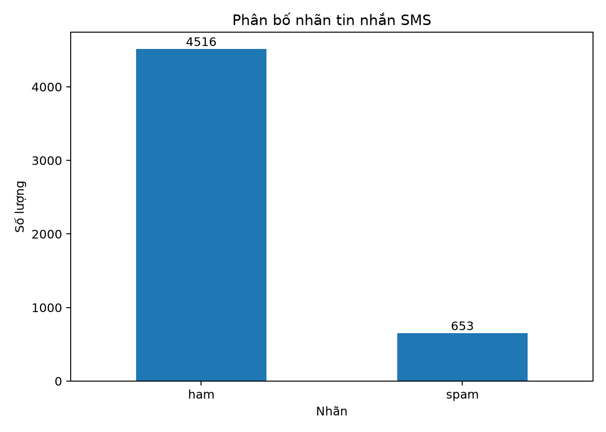
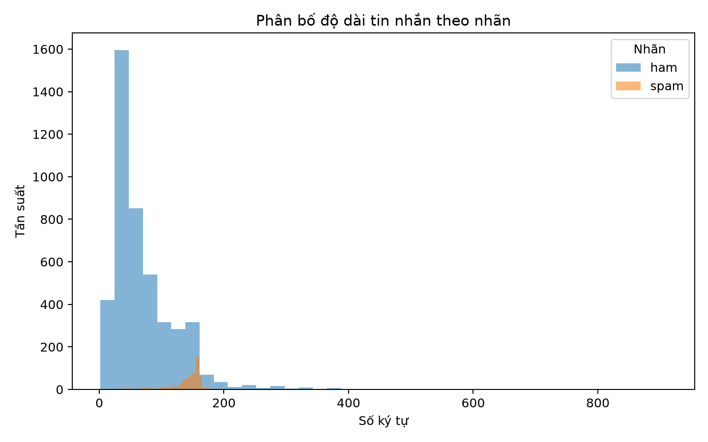

# Báo cáo EDA – SMS Spam Collection

## 1. Giới thiệu
Bộ dữ liệu gồm tin nhắn SMS được phân thành hai nhãn: `ham` (tin nhắn bình thường) và `spam` (tin nhắn rác). Mỗi bản ghi có nhãn và nội dung tin nhắn.

## 2. Kiểm tra và làm sạch
- Tệp dữ liệu có **5,574 dòng vật lý**. Khi đọc theo định dạng TSV có hỗ trợ nội dung nhiều dòng, thu được **5,572 bản ghi**; một tin nhắn chứa hai ký tự xuống dòng nên số dòng vật lý lớn hơn số bản ghi hai dòng.
- Bản ghi thiếu nhãn: **0**; bản ghi thiếu nội dung: **0**; bản ghi thiếu ít nhất một trong hai trường: **0**.
- Bản ghi có nhãn không hợp lệ sau khi bỏ khoảng trắng và chuyển nhãn về chữ thường: **0**.
- Bản ghi trùng hoàn toàn theo cặp `label` và `text` đã loại: **403** (giữ bản ghi đầu tiên).
- Nội dung có nhiều nhãn khác nhau: **0**; số bản ghi liên quan: **0**. Các trường hợp xung đột được thống kê riêng và không bị loại vì khác nhãn.
- Bản ghi TSV hợp lệ trước khi loại trùng: **5,572**; bản ghi sau xử lý: **5,169**.
- Bản ghi sai định dạng TSV (không có đúng hai trường): **0** trong lần kiểm tra này. Loader đếm và loại riêng những bản ghi sai cấu trúc.
- Schema đầu ra của `load_dataset()` gồm đúng hai cột `label`, `text`; dữ liệu sau xử lý không có giá trị thiếu hoặc duplicate hoàn toàn.

Loader chỉ xem label hoặc text rỗng/thiếu là dữ liệu thiếu. Nội dung tin nhắn không bị chuẩn hóa hoặc sửa. Nhãn được bỏ khoảng trắng ở hai đầu và chuyển về chữ thường; chỉ giữ `ham` và `spam`.

## 3. Phân bố nhãn
Tập dữ liệu sau xử lý có **5,169** tin nhắn:
- Ham: **4,516** (87.37%).
- Spam: **653** (12.63%).

Lớp ham chiếm tỷ lệ lớn hơn spam, cho thấy dữ liệu mất cân bằng nhãn. Khi đánh giá mô hình, nhóm nên xem thêm Precision, Recall và F1-score thay vì chỉ dùng Accuracy.

## 4. Độ dài tin nhắn
Bảng dưới đây mô tả số lượng và độ dài tin nhắn theo từng nhãn (đơn vị: ký tự):

| label   |   count |   mean |   median |   min |   max |
|:--------|--------:|-------:|---------:|------:|------:|
| ham     |    4516 |  70.91 |       53 |     2 |   910 |
| spam    |     653 | 137.70 |      148 |    13 |   223 |

Độ dài tin nhắn có thể là một đặc trưng hỗ trợ phân loại, tuy nhiên không đủ để kết luận một tin nhắn là spam hay ham nếu đứng riêng lẻ.

## 5. Kết luận
Notebook EDA được cung cấp trong repository cùng hai biểu đồ phân phối nhãn và độ dài tin nhắn. Hàm `load_dataset()` trả về schema gồm hai cột `label`, `text`, tương thích với pipeline huấn luyện. Qua quá trình khám phá dữ liệu, bộ SMS Spam Collection sau làm sạch gồm 5.169 tin nhắn, không còn dữ liệu thiếu, nhãn không hợp lệ hoặc bản ghi trùng hoàn toàn. Tập dữ liệu có sự mất cân bằng giữa hai lớp ham và spam. Ngoài ra, tin nhắn spam có độ dài trung bình lớn hơn tin nhắn ham. Những đặc điểm này là cơ sở để lựa chọn phương pháp tiền xử lý và đánh giá các mô hình phân loại ở giai đoạn tiếp theo.
